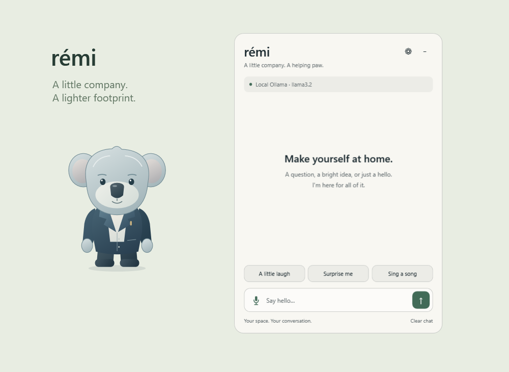

# Rémi

A little company. A lighter footprint.

Rémi 2 is a **native Windows desktop companion**, rebuilt with C#/.NET 10 and WPF. It ships without Electron, Chromium, Node, React, or Three.js. Choose a tailored professional companion, the original cute koala, or a rounded armored robot. Each is native vector artwork that stays sharp at any desktop size.



## Run

Windows 10/11 is required. This rewrite targets Windows; it does not currently provide macOS or Linux builds.

For a packaged build, extract the entire ZIP and run `Remi.exe`. The small `desktop-runtime` package requires the [.NET 10 Desktop Runtime](https://dotnet.microsoft.com/en-us/download/dotnet/10.0); the larger `standalone` package includes it. Keep the `Voice` folder alongside the executable for microphone input.

From source, install the [.NET 10 SDK](https://dotnet.microsoft.com/en-us/download/dotnet/10.0), then:

```powershell
dotnet run --project native/Remi.Desktop -c Release
```

Node and npm are optional. `npm start`, `npm run build`, `npm test`, and `npm run package` are aliases for the native tools; the root package has no JavaScript dependencies.

## Meet your companion

- Click Rémi to open chat; drag him to move. His position is saved and recovered onto a visible monitor.
- Right-click Rémi for chat, settings, hide, and **Close Rémi**, which quits the application and removes its tray icon.
- Use the tray or **Ctrl+Shift+B** to show or hide him. A second launch opens the existing companion.
- Replies stream into a separate, compact chat window. Enter sends, Shift+Enter adds a line, and the stop button cancels. Escape closes chat and stops active input or generation.
- Ask for a joke, a surprising fact, or a few lines of *In My Merry Oldsmobile*.
- Native Windows voices read replies aloud. Select a voice and speaking speed in settings.
- Press the microphone to record; press again to transcribe and send. Recording stops automatically at 45 seconds. Stop discards recording or cancels transcription.
- In **Settings → Companion**, choose **Professional** (default), **Cute Rémi**, or **Robot**. The robot has a pearl visor helmet, red-and-gold armor, cyan display eyes, and a luminous chest core. Koalas support three coat colors, four outfits, and sunglasses. All styles support 50–150% desktop size.
- Choose **Eucalyptus**, **Slate**, or **Midnight** application themes. Optional accent and background colors accept `#RRGGBB`; leave blank for preset colors. Themes preview immediately; Cancel restores your saved theme. All three settings tabs share equal dimensions.
- Reduce motion disables blinking and expressive movement. Invisible parts of the pet window remain transparent to clicks.

## Ollama

Install [Ollama](https://ollama.com/download) and pull a model:

```powershell
ollama pull llama3.2
```

The default host is `http://127.0.0.1:11434`. Open **Settings → Connection** to set a host and model; **Refresh available models** lists installed models. If the selected model is unavailable, Rémi selects an available model and shows its name in chat. Cloud models work through an Ollama installation configured to use them. Custom hosts may include a proxy path; this version does not provide custom authentication headers.

**Release the model after each reply** is enabled by default. It requests `keep_alive: "0"` from Ollama, trading a slower next reply for freeing model memory between chats. Disable it to keep the model warm for five minutes. Ollama's CPU, GPU, and memory usage are separate from Rémi's process.

## OpenAI / ChatGPT models

In **Settings → Connection**, select **OpenAI · ChatGPT models**, enter an OpenAI API key, and save. This connection uses the OpenAI API and its separate usage billing. It does not sign into the ChatGPT application. `gpt-4.1-mini` is the initial model; type another Responses-compatible model ID or refresh the list available to your API account. See the official [OpenAI model documentation](https://developers.openai.com/api/docs/models/gpt-4.1-mini) and [API pricing](https://developers.openai.com/api/docs/pricing).

Keys are encrypted with Windows DPAPI for the current user in `%LOCALAPPDATA%\Remi\openai-key.bin`, separate from preferences. Leave the key field blank to retain the saved key, enter a replacement, or choose **Remove saved key** and save. `OPENAI_API_KEY` is also supported as a fallback; removing a saved key does not remove that environment variable.

Rémi streams Responses API events directly, with cancellation, bounded conversation context, and `store: false` to disable response-object storage. This does not override OpenAI's other data-retention policies; see [OpenAI conversation-state documentation](https://developers.openai.com/api/docs/guides/conversation-state). Switching providers clears the current chat so your existing local conversation is not automatically forwarded to OpenAI. API keys are attached only to OpenAI requests. Ollama does not need to run when OpenAI is selected.

## Optional local voice input

Text chat and speech output work without Python. For microphone input, install Python and Whisper:

```powershell
python -m pip install openai-whisper
```

Choose a microphone, Python executable, and `tiny`, `base`, or `small` Whisper model in **Settings → Voice**. The first transcription downloads the selected model; later transcriptions can run offline. `tiny` uses the fewest resources. No microphone is opened at launch.

Rémi records mono 16-bit, 16 kHz PCM directly to WAV. Its Python helper reads PCM into Whisper directly, so **ffmpeg is not required**. Whisper runs in a short-lived CPU process with at most four inference threads and a three-minute timeout. Cancelling kills that process; temporary audio and transcripts are removed after completion, error, or cancellation. No background transcription server stays loaded. Windows microphone privacy settings must permit desktop applications to use the microphone.

## Privacy and settings

Conversations are retained only in application memory; clear chat or quit to discard the local copy. Chat messages go only to the selected provider: your Ollama host or OpenAI. Remote hosts and cloud models follow their provider's privacy policies. Rémi has no telemetry, auto-updater, startup registration, or background model polling.

Preferences are stored in `%LOCALAPPDATA%\Remi\settings.json`, written atomically. Invalid settings fall back to defaults; the original file is preserved until you explicitly save settings. Startup errors are written to `startup-error.log` in the same directory.

The historical source and configuration remain in [legacy/electron](legacy/electron/README.md). Pre-existing root `dist/` output is preserved and is not used by the new app.

## Build, test, and package

```powershell
dotnet build Remi.slnx -c Release
powershell -NoProfile -File scripts/test.ps1
powershell -NoProfile -File scripts/publish.ps1
powershell -NoProfile -File scripts/publish.ps1 -SelfContained
```

Packages go into `artifacts/`. `-Runtime win-arm64` builds for ARM64; runtime validation has been performed on x64. Publishing uses ReadyToRun and a single executable plus the Python helper. WPF is not trimmed. No installer or administrator privileges are needed.

`scripts/test.ps1` runs 18 deterministic core checks and exercises the actual WPF windows with HTTP fixtures for both providers: Unicode streaming, cancellation, errors, credential isolation, all companion styles, equal tabs, theme preview/cancel, settings save/reopen, DPAPI key roundtrip/removal, tray, shortcuts, and the companion menu's close action. It writes native screenshots to `artifacts/preview/`, without reading or writing user preferences or accessing the microphone. OpenAI validation uses a synthetic key and fixture responses, not a live API account. The preview above is rendered from these real WPF controls.

Optional integration checks use existing local installations:

```powershell
# One real request to an installed local model; requests immediate model release.
dotnet run --project tests/Remi.Core.Tests -c Release -- --live --model=llama3.1:8b

# Generates speech into a WAV file and transcribes it; no microphone capture.
powershell -NoProfile -File scripts/test-voice.ps1 -Model tiny

# Measures the visible idle pet, including tray, shortcut, and blinking.
powershell -NoProfile -File scripts/benchmark.ps1
```

## Why it is lighter

One native application process replaces the bundled browser and JavaScript runtime. The retained vector character has no continuous render loop; idle activity is limited to a short blink about every six seconds. Expressive animations run at 20 fps only while active and stop when hidden. Chat is constructed on first use, speech is initialized on demand, and microphone capture and Whisper exist only during explicit voice input. Model context is capped at 24 recent messages, UI history at 100 entries, and streamed text updates are coalesced to at most 20 per second.

The measured idle sample on this machine used **127.9 MiB working set and 76.4 MiB private memory**, compared with **399.8 MiB and 283.1 MiB** for the archived Electron renderer across six processes. CPU was 1.692% versus 17.164% of one logical core. This is a short application-level comparison using each version's default size, with no inference or microphone capture. Results vary by machine and are not a universal framework comparison. See [implementation and validation notes](docs/architecture.md) for the procedure, raw measurements, and limitations.

The implementation follows the official [WPF desktop documentation](https://learn.microsoft.com/en-us/dotnet/desktop/wpf/overview/) and [Ollama streaming chat API](https://docs.ollama.com/api/chat).

## License and support

MIT — see [LICENSE](LICENSE). [Buy me a coffee](https://buymeacoffee.com/mgaillardetz).
